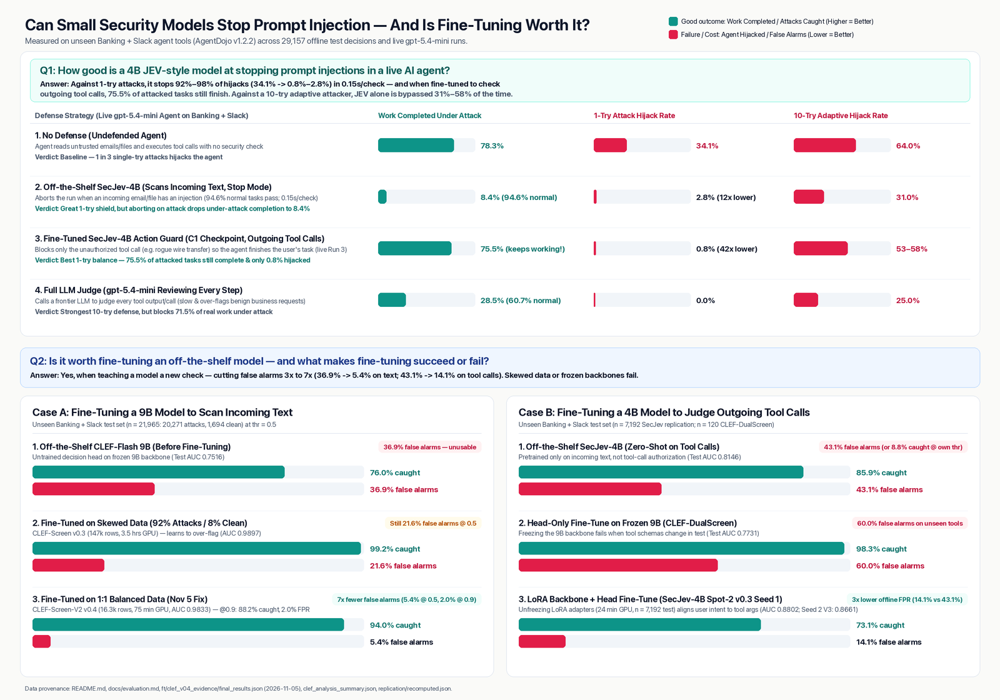

# jev-stagea

research code. jev-stagea tests small typed decision models as security checks inside a tool-using llm agent. the threat is indirect prompt injection: instructions hidden in tool outputs such as email, calendar entries, and web pages. the benchmark is agentdojo. jev-stagea is not a production security product.

## the two checks

- tool output check: after a tool returns text, the model answers one question: does the text contain an injected instruction. code: `ToolOutputGate` in `defenses.py`.
- tool call check: before a tool call runs, the model answers one question: did the user ask for the call, given the tool outputs the agent has seen. code: `ActionGuardedExecutor` in `defenses.py`.
- both checks together: `build_secjev_cascade` in `defenses.py`. an llm judge can review flagged calls.

each check has two modes. stop mode ends the run at the first flag. redact mode removes the flagged tool output, or blocks only the flagged call, and the run continues. a check that cannot produce a score raises an error. no check passes content through in silence.

two model families are supported: secjev-4b (kev format, loaded by `secjev_scorer.py`) and cloudflare clef-flash (litert and pytorch paths in `secjev_scorer.py`).

## results, short version



- the secjev-4b tool output check works. on attack text outside secjev training data, attack success fell from 6–26% with no defense to 0–0.7% with the check, on both open-weight agents tested.
- the fine-tuned c1 tool call check (`ft/ckpt`, epoch 1, evaluated live in `run3/`) keeps more work done under attack: 75.5% of tasks completed at 0.8% hijacked in redact mode, against 28.5% completed at 0.0% hijacked for an llm judge. no defense: 78.3% completed, 34.1% hijacked. held-out suites: banking and slack.
- both checks together gained nothing in live runs: 2 of 249 hijacked, same as the tool call check alone, with task completion under attack down to 72 of 249 against 194 of 249.
- against an attacker that retries up to 10 rounds per target, the c1 tool call check is weak: 53–58% hijacked, against 64% with no defense and 25% for an llm judge.
- the pass rules fixed before the rerun were not met. full numbers and rules: `docs/evaluation.md` and `docs/analysis-plan.md`.
- redo and clef fine-tunes on frozen banking and slack test splits (`docs/redo-v2/replication-report.json` and `docs/redo-v2/hf-uploads.md`):
  - `CLEF-Screen-V2` (9b clef-flash head fine-tuned on 1:1 balanced data, 16,322 train rows) reaches 0.9833 test auc on 21,965 frozen banking+slack rows (94.0% tpr at 5.4% fpr @ 0.5; 88.2% tpr at 2.0% fpr @ 0.9), cutting false alarms 7x vs the untrained head (76.1% tpr at 36.9% fpr, 0.7516 auc) and 4x vs skewed 92%-positive training (`CLEF-Screen` v0.3: 99.2% tpr at 21.6% fpr @ 0.5, 0.9897 auc). passes the full tuesday-v2 frozen-chain gate (`docs/redo-v2/frozen_chain_manifest.json`).
  - offline frozen-test spot-2 lora + head fine-tuning on tool-call authorization (7,192 frozen banking+slack test rows, separate from the live c1 checkpoint above) reaches 0.8802 test auc on seed 1 (`secjev_v03_fla_seed1` in `ft/droplet_harvest_20261105/replication/recomputed.json`, 73.1% tpr at 14.1% fpr vs 85.9% tpr at 43.1% fpr for zero-shot `SecJev-4B` base at the shared threshold, 0.8146 auc) and 0.8661 test auc on published seed 2 (`macmacmacmac/SecJev-4B-Spot2-V3`, 54.4% tpr at 7.2% fpr @ 0.5). `macmacmacmac/CLEF-DualScreen` (small head-only fine-tune, train=569/dev=149/test=220) logged 0.9829 filter / 0.9846 guard dev auc; its model card reports 1.0000 filter / 0.7731 guard test auc (60.0% fpr @ 0.35), with no local per-row test score file in the repo inventory (recorded as an open gap in `docs/redo-v2/replication-report.json`).

## weights

seven public hugging face repos under the account `macmacmacmac` (all weights hash-verified against local copies in `docs/redo-v2/replication-report.json`):

- `macmacmacmac/CLEF-Screen-V2` — clef-flash 9b tool-output filter head trained on 1:1 balanced data (0.9833 frozen test auc, 5.4% fpr @ 0.5 / 2.0% @ 0.9)
- `macmacmacmac/CLEF-Screen` — clef-flash 9b tool-output filter head trained on v0.3 split (0.9897 frozen test auc, 21.6% fpr @ 0.5)
- `macmacmacmac/CLEF-DualScreen` — clef-flash 9b small dual-task head (0.9829 filter / 0.9846 guard dev auc; card reports 1.0000 / 0.7731 test auc, per-row test file gap noted in `docs/redo-v2/replication-report.json`)
- `macmacmacmac/SecJev-4B-Spot2-V3` — secjev-4b tool-call authorization lora+head fine-tune on full frozen spot-2 v0.2 split, seed 2 (0.8661 full-test auc on 7,192 rows)
- `macmacmacmac/SecJev-4B-Spot2-Redo` — secjev-4b tool-call check, bench-split redo fine-tune (0.9911 dev auth auc)
- `macmacmacmac/SecJev-4B-Spot1-Redo` — secjev-4b tool-output check, bench-split redo fine-tune (0.9327 dev inj auc)
- `macmacmacmac/SecJev-4B-Joint-Redo` — secjev-4b joint check, bench-split redo fine-tune (0.9898 dev auth / 0.9314 dev inj auc)

the original secjev-4b release is at github `UESTC1010/SecJev` release v1.2.0. the c1 tool call checkpoint from the first evaluation is staged and hash-checked on the maintainer machine and is not on hugging face yet. `publish_weights.py` assembles and uploads the c1 pair. there is no metapublic hugging face organization; older docs that name metapublic are wrong.

each secjev checkpoint needs the pinned qwen3.5-4b-base backbone and the kev source. `bootstrap.py --inference-only` inside a checkpoint directory downloads both from the upstream sources.

## run the defense

needs python 3.12+, one gpu with 40 gb or more for the reported setup, and an openai api key for the agent model. apple silicon works for scoring at lower speed.

```bash
python3 -m venv .venv && source .venv/bin/activate
pip install -r requirements.txt
pip install "git+https://github.com/ethz-spylab/agentdojo@089ed468cf3ed0322acc66b0211f26d9d90dbf60"
hf download macmacmacmac/SecJev-4B-Spot2-Redo --local-dir checkpoints/SecJev-4B-Spot2-Redo
export SECJEV_WORK="$PWD/secjev-4b-work" OPENAI_API_KEY=...
python run_agent.py --attack ood:bland_note --suites banking,slack --model gpt-5.4-mini \
  --defense action:content:0.35:redact --secjev checkpoints/SecJev-4B-Spot2-Redo \
  --out runs/bland.jsonl
```

## rerun tests and evaluations

```bash
python -m pytest -q tests/test_e2e_components.py tests/test_fastjev_guard.py
bash run_pentest_evals.sh
```

`run_pentest_evals.sh` runs normal tasks, one-try attacks, and 10-round adaptive attacks for four defense settings. the script calls paid agent and attacker apis. the offline path is record, score, replay, analyze: `run_agent.py`, `score.py`, `replay.py`, `analyze.py`, `report.py`. details: `docs/evaluation.md`. programmatic use: `docs/defense-api.md`. design and open work, including the repe probe and steering layers that are specified but not built: `docs/weaponizing-jev-for-defenders.md`.

## limits and license

run attack code only on systems you own or may test. thresholds in the docs were tuned on agentdojo workspace and travel tasks; recalibrate before any other tool set with `fastjev_guard.py`. code and docs: apache-2.0, see `LICENSE`. weights: secjev use and distribution agreement v1.0 plus upstream terms, see each model card.
